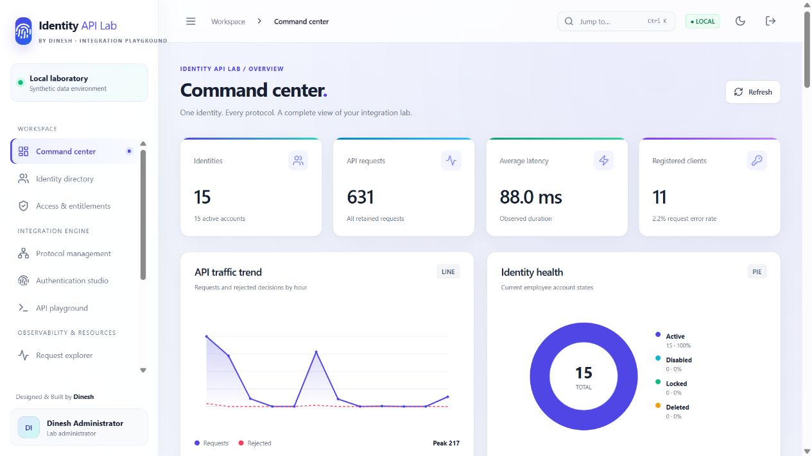
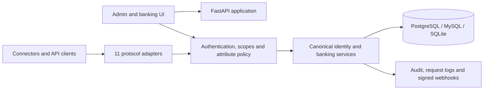

# Identity API Lab

**A universal identity integration and banking workflow sandbox — designed and built by [Dinesh](https://www.linkedin.com/in/dineshwarmanukonda/).**

Identity API Lab is a lightweight, self-hosted environment for testing identity lifecycle, API authentication, authorization, federation, banking permissions and operational evidence against one canonical data model. It ships with 15 fictional employees across 15 countries, realistic departments and roles, sample customers, accounts, transactions, payment approvals and audit history.

> This is a testing lab. It does not connect to a bank or contain real customer data. Protocol support is described as an implemented profile; it is not a blanket standards certification.

[Download the 10-page product brochure](docs/brochure/Identity-API-Lab-Product-Brochure.pdf) · [View architecture](docs/HLD.md) · [Read the API contract](backend/API_CONTRACT.md) · [Support the project](SUPPORT.md)



## Highlights

- **11 protocol adapters:** REST, SCIM 2.0, SCIM 1.1, SOAP 1.1, SOAP 1.2, GraphQL, OData 4.0, native gRPC, JSON-RPC 2.0, signed webhooks and CSV/SFTP.
- **7 client authentication methods:** OAuth 2.0 Client Credentials, Authorization Code with S256 PKCE, API key, HTTP Basic, HTTP Digest, JWT bearer and HMAC SHA-256 request signing.
- **Identity governance:** custom permissions, roles and groups; role assignment; effective access; API-readable and API-writable attribute policies.
- **Federation studio:** Microsoft Entra ID, Okta and generic OpenID Connect configuration, claim mapping, account correlation, domain controls and optional just-in-time provisioning. SAML metadata is available for deployment integration.
- **Permission-aware banking portal:** each employee sees modules and actions derived from live effective permissions; maker/checker payments enforce separate initiator and approver identities.
- **Operational evidence:** request explorer, audit trail, token/session revocation and colorful dashboards for traffic, latency, failures, geography, activity, sessions and risk.
- **Three database choices:** PostgreSQL, MySQL or a small SQLite setup.

## Install in one command

Install Docker Desktop, clone this repository, then run:

```powershell
# Windows PowerShell
powershell -ExecutionPolicy Bypass -File .\scripts\lab.ps1 install
```

```sh
# macOS or Linux
sh scripts/lab.sh install
```

Open **http://localhost:8787**. Sign in as `admin` with `ADMIN_PASSWORD` from the generated `.env`. Active sample employees use `DEMO_PASSWORD`. The installer generates secrets, builds the application, initializes the database and waits for health checks. It does not print passwords into build logs.

The default installation uses PostgreSQL. Choose another database with `scripts/install.ps1 -Database mysql`, `scripts/install.ps1 -Database sqlite`, `sh scripts/install.sh mysql`, or `sh scripts/install.sh sqlite`. Each choice uses a separate data volume.

The repository also includes `railway.json` for a Railway deployment and `render.yaml` for a Render blueprint. Add a managed PostgreSQL service, set the documented environment variables and expose the HTTP service. Native gRPC additionally needs a platform TCP endpoint.

## Useful commands

```powershell
.\scripts\lab.ps1 status
.\scripts\lab.ps1 verify
.\scripts\lab.ps1 logs
.\scripts\lab.ps1 restart
.\scripts\lab.ps1 update
.\scripts\lab.ps1 stop
```

Use `sh scripts/lab.sh <action>` on macOS/Linux. HTTP binds to loopback port 8787 and gRPC to loopback port 50051 by default. Configure `APP_PORT`, `GRPC_PORT` and `APP_BIND` in `.env` when needed.

## Core routes

| Area | Route |
|---|---|
| Web application | `/` |
| Health | `/health` |
| REST users | `/api/v1/users` |
| SCIM 2.0 | `/scim/v2/Users`, `/scim/v2/Groups` |
| SCIM 1.1 | `/scim/v1/Users` |
| SOAP and WSDL | `/soap`, `/soap?wsdl` |
| GraphQL | `/graphql` |
| OData 4.0 | `/odata/v4/$metadata`, `/odata/v4/Users` |
| JSON-RPC 2.0 | `/jsonrpc` |
| CSV | `/api/v1/csv/users` |
| Native gRPC | `localhost:50051`, service `identitylab.v1.IdentityService` |
| OpenAPI | `/docs`, `/openapi.json` |
| Administration | `/admin-api/*` |
| Banking simulator | `/banking/*` |

The [API contract](backend/API_CONTRACT.md) contains complete request examples, scopes, cURL commands and gRPC usage. The [capability matrix](docs/CAPABILITIES.md) states the precise boundary of every adapter.

## End-to-end identity test

1. Enable the required protocol adapters in Protocol Management.
2. Register a client, select authentication methods, scopes, protocols and attribute policy, then copy the one-time secret.
3. Obtain a scoped token and create an employee with SCIM.
4. Assign a role through REST and query effective permissions through GraphQL.
5. Sign in as the employee and confirm the banking interface reflects the granted permissions.
6. Disable the employee through SOAP and confirm every adapter and the portal reads the disabled state.
7. Inspect the request, authentication decision, duration, audit event and related identity change.
8. Revoke the token or client credential and confirm subsequent calls fail.

SCIM 1.1, OData, gRPC, JSON-RPC and CSV operate on the same records. Webhooks publish signed lifecycle events. SFTP imports and exports the same CSV profile with strict host-key verification.

## Architecture

The product is a modular monolith: a React interface and FastAPI service share a policy layer, domain services and SQLAlchemy record store. Every adapter calls those services, so there are no disconnected mock APIs. See the [high-level design](docs/HLD.md), [low-level design](docs/LLD.md), [architecture decisions](docs/ARCHITECTURE.md), [security model](docs/SECURITY.md), [deployment guide](docs/DEPLOYMENT.md) and [acceptance evidence](docs/ACCEPTANCE.md).



## Security posture

The lab uses hashed passwords and client secrets, encrypted stored connector credentials, short-lived codes and tokens, revocation checks, CSRF protection, host validation, body and query limits, GraphQL complexity limits, XML hardening, webhook signing, SFTP host-key pinning and object/operation authorization. The design follows [SCIM RFC 7644](https://www.rfc-editor.org/rfc/rfc7644), [OAuth Security BCP RFC 9700](https://www.rfc-editor.org/rfc/rfc9700) and the [OWASP API Security Top 10](https://owasp.org/API-Security/).

Before any internet-facing deployment, terminate TLS at a trusted proxy, set secure cookies, replace demonstration credentials, restrict allowed hosts and outbound destinations, use managed secrets, back up the database, centralize audit logs and complete an independent security review.

## Development and verification

Python 3.12+ and Node.js 22+ are recommended.

```sh
python -m venv .venv
# Windows: .venv\Scripts\Activate.ps1
# macOS/Linux: . .venv/bin/activate
pip install -r backend/requirements.txt
pip install -r tests/requirements.txt
python -m pytest tests -q
cd frontend
npm ci
npm run build
```

Run `scripts/lab.ps1 verify` or `scripts/lab.sh verify` against an installed environment. Release evidence belongs in [docs/ACCEPTANCE.md](docs/ACCEPTANCE.md); a passing test suite demonstrates the implemented profiles, not all optional behavior of every named standard.

## Repository layout

```text
backend/     application, adapters, domain services, protobuf contract
frontend/    React and TypeScript interface
scripts/     installation, operation and verification tools
tests/       integration and security regression suite
docs/        architecture, API scope, security and deployment documents
```

## License and author

Copyright 2026 Dinesh. All rights reserved. The repository is distributed under the included [proprietary license](LICENSE). Author and contact details are in [AUTHORS.md](AUTHORS.md), [NOTICE](NOTICE), the application About page and [LinkedIn](https://www.linkedin.com/in/dineshwarmanukonda/).

GitHub sponsorship configuration is included in `.github/FUNDING.yml`. The Sponsor button becomes active after the repository owner completes GitHub Sponsors enrollment and payout verification.
