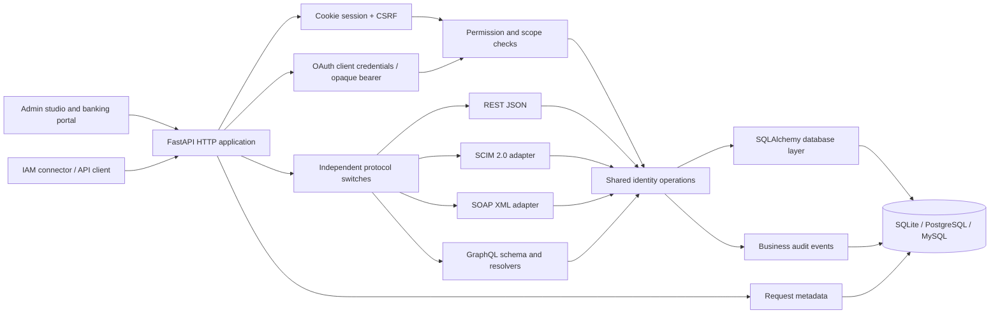
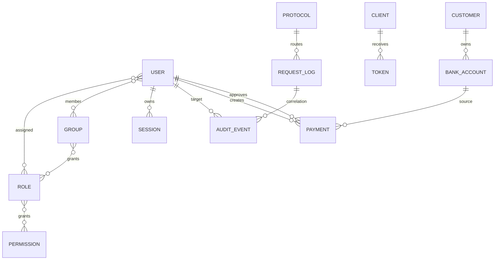
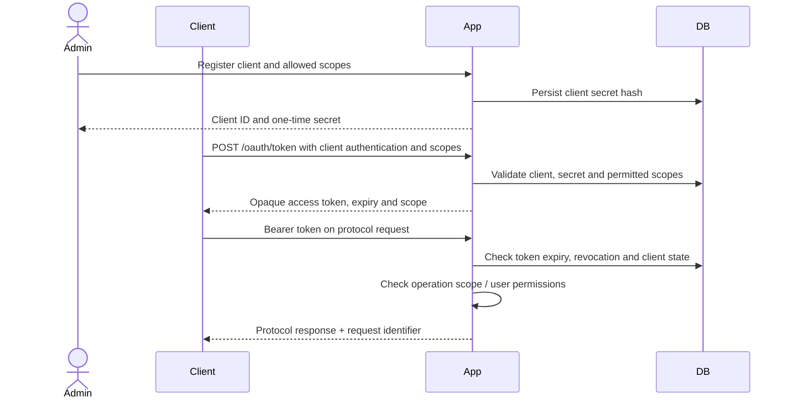
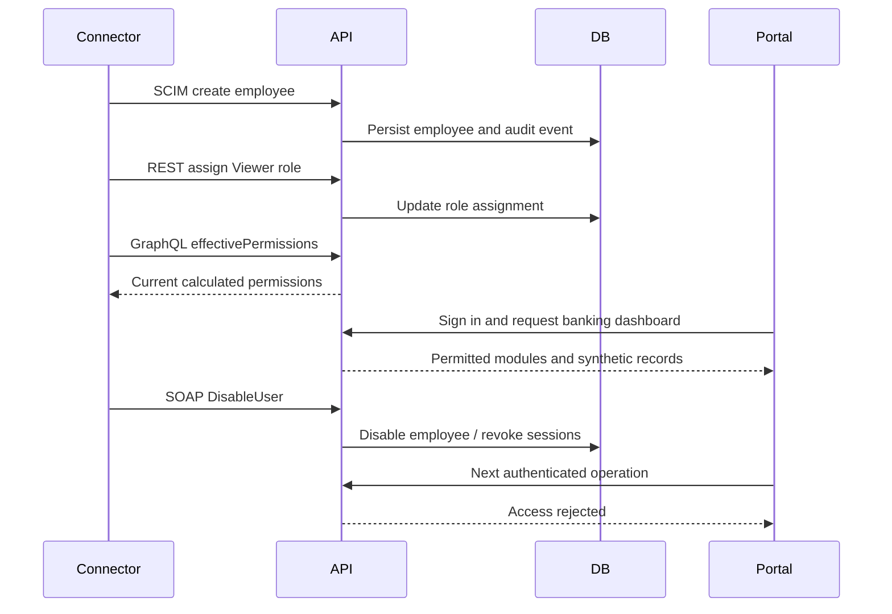
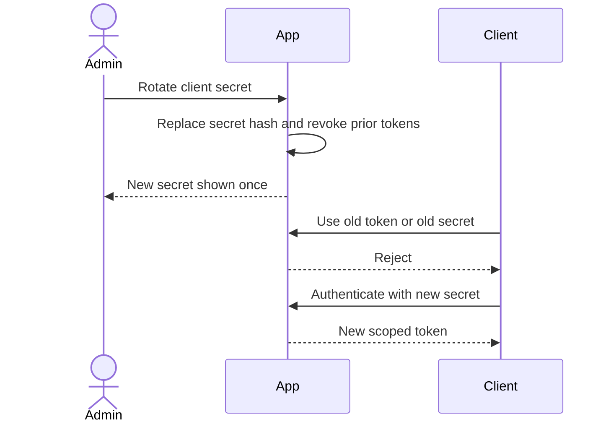
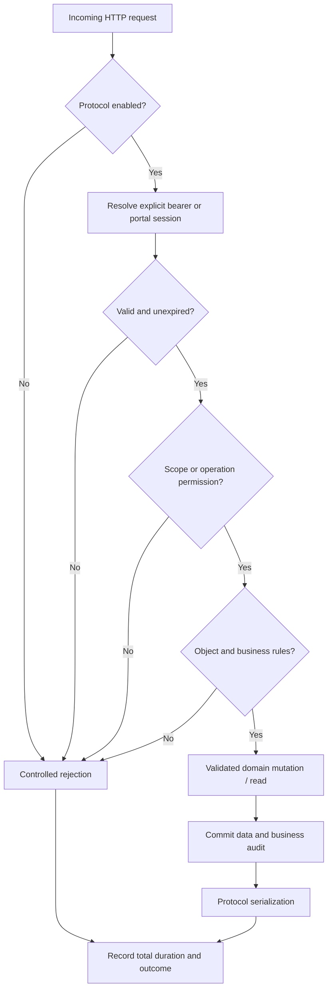

# Identity API Lab — architecture and decisions

Designed & Built by Dinesh. Meridian Finance Demo contains synthetic employees and banking records; it does not send payments or connect to a financial institution.

## Product scope

The first delivery is a lightweight, runnable vertical slice of the master specification. Its acceptance boundary is a shared employee lifecycle across REST, SCIM 2.0, SOAP and GraphQL, scoped client credentials, a permission-controlled banking portal, request evidence and immediate revocation. Consult [CAPABILITIES.md](CAPABILITIES.md) for explicit limitations. A page or planned adapter is not evidence of implemented support.

## System and component architecture

The same database state is read by every adapter. There is no asynchronous synchronization queue. A successful committed lifecycle mutation is visible to the next request through other enabled protocols. Protocol switches apply to integration routes; they do not switch off administrative recovery routes.

## Architecture decision records

| Decision | Reason | Consequence |
|---|---|---|
| Modular monolith | One small local deployment and one canonical identity state | No mandatory Redis, Kafka or Kubernetes |
| FastAPI and SQLAlchemy | Small Python service, mature HTTP and parameterized database layer | Python is a deliberate substitute for the suggested TypeScript backend |
| SQLite quick start | Zero database installation for a disposable lab | External PostgreSQL/MySQL remain separate selectable deployments; portability requires running tests on each |
| Server-side opaque tokens | Direct expiry and revocation checks with no signing-key infrastructure | No JWT/JWKS/audience-signature feature claim |
| Cookie portal sessions | HttpOnly credentials and CSRF checks on mutations | Production deployment must enforce TLS and secure-cookie settings |
| Request metadata only | Avoid storing secrets and personal request bodies | Request Explorer cannot reproduce full request/response payloads or accurate per-stage timing |
| Shared authorization | Banking and APIs enforce permission/scope checks on the server | UI visibility complements server enforcement |

## Logical data model

This is the logical relationship diagram. The initial physical database uses a single `lab_records` table with a primary key, indexed record kind and JSON text body; associations are collections of identifiers in those records. Application code validates references. It does not provide the master's normalized tables, database foreign keys, database-enforced username uniqueness or concurrent-update guarantees. The compact representation reduces setup complexity but requires a future normalized migration for large or concurrent deployments. The generated database schema is authoritative for physical tables and constraints.

## OAuth client credentials flow

## Lifecycle and session invalidation

## Credential rotation

## Authorization and observability

Request IDs and correlation IDs connect HTTP metadata to business audit events. Total HTTP duration is measured; no invented timing spans are presented as instrumented measurements. Metrics are derived from stored requests. Logs are local lab records, not a tamper-proof external audit store.
