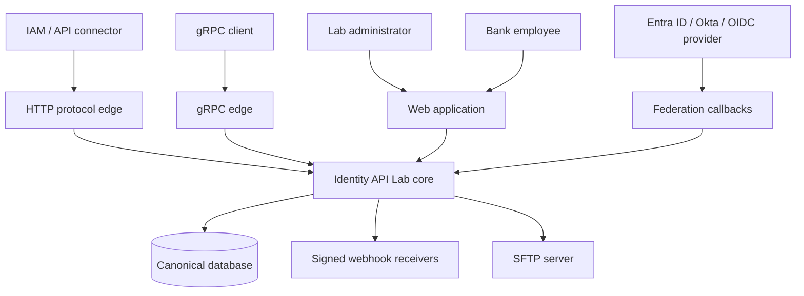
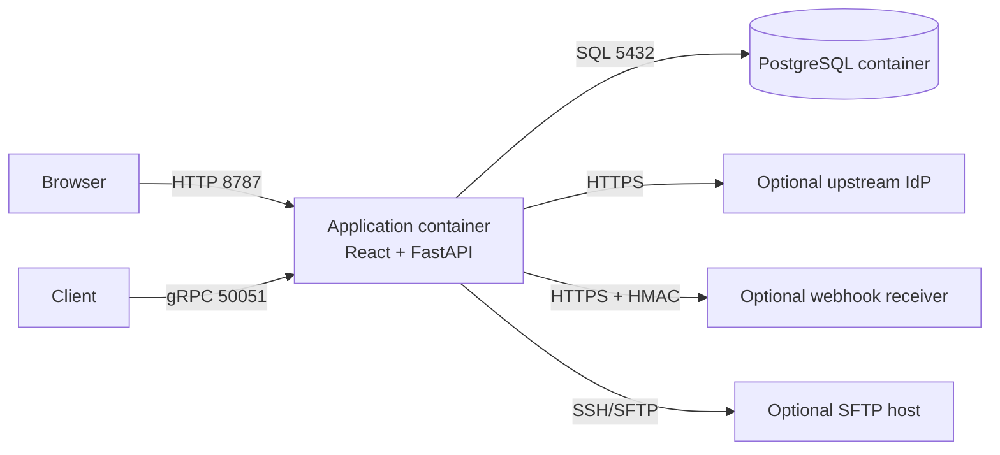
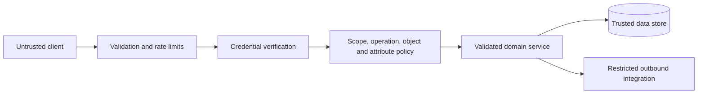

# High-level design

## Purpose

Identity API Lab gives developers and IAM teams one disposable environment where multiple integration protocols, authentication methods and a permission-aware business application operate on the same identity state.

## Context

## Containers and ports

The standard Docker setup exposes HTTP and gRPC only on loopback. PostgreSQL is private to the Compose network. MySQL and SQLite variants preserve the same application contract.

## Major components

| Component | Responsibility |
|---|---|
| React application | Command Center, Authentication Studio, protocol management, request explorer, directory, access administration, banking portal and audit views |
| HTTP edge | Routing, request limits, security headers, request IDs, timing and error normalization |
| Authentication | Browser sessions, client credentials, PKCE, API key, Basic, Digest, JWT and HMAC verification |
| Authorization | Client scopes, permitted protocols, attribute read/write policy, permissions, maker/checker and object checks |
| Protocol adapters | Translate protocol-specific requests into canonical domain operations and serialize results |
| Domain services | Identity lifecycle, role/group access, payments, sessions, clients, federation and evidence |
| Persistence | Typed JSON records through SQLAlchemy on PostgreSQL, MySQL or SQLite |
| Integration egress | Signed webhooks, OIDC discovery/token calls and pinned-key SFTP transfers |
| Observability | Request metadata, authentication result, duration, correlation and immutable-style business audit entries |

## Trust boundaries

Secrets are accepted only through headers or request bodies, redacted from stored request metadata and hashed or encrypted at rest. Public deployment requires TLS termination and managed secret storage.

## Availability and scale

The release favors a small footprint and local reproducibility. It runs as one stateless application process plus a database. Multiple HTTP replicas require a shared database and externally coordinated rate limiting; the native gRPC listener requires a platform that exposes TCP. Large, high-availability or regulated deployments need database migrations, external observability, secret management, backups, load tests and an independent security review.

## Key quality attributes

- **Consistency:** all protocol adapters commit to and read from one canonical store.
- **Security:** every operation passes authentication, protocol, scope, attribute and business policy checks.
- **Traceability:** request IDs correlate transport activity with identity and banking audit events.
- **Portability:** Docker Compose supports PostgreSQL, MySQL and SQLite profiles.
- **Testability:** synthetic global data and deterministic APIs allow repeatable lifecycle scenarios.
