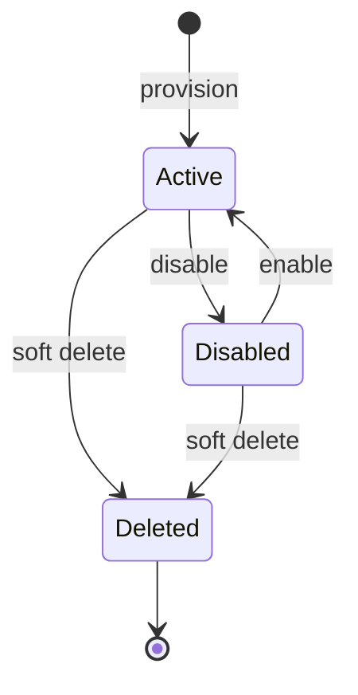
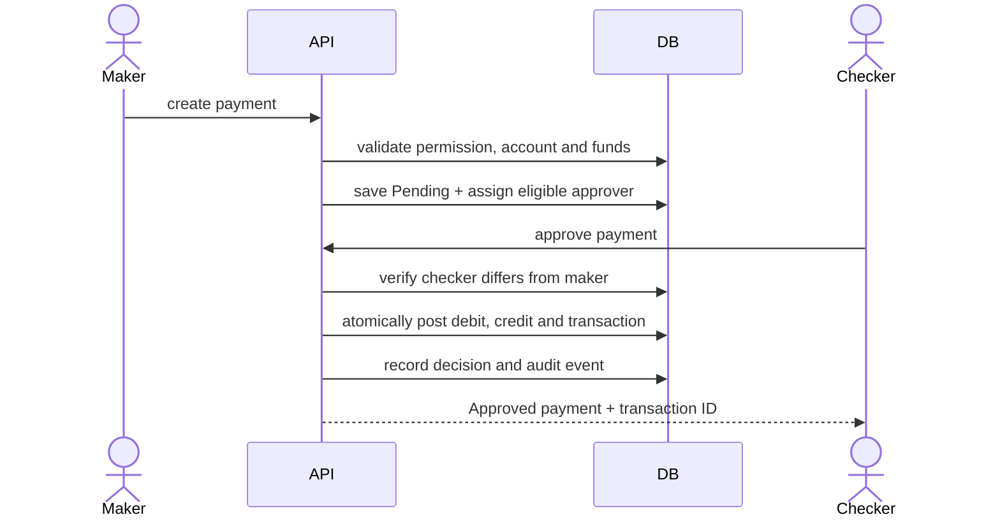

# Low-level design

## Request pipeline

1. The HTTP or gRPC edge assigns a request identifier and enforces size and complexity limits.
2. The protocol registry verifies that the adapter is enabled.
3. Authentication resolves a browser session, bearer token, API key, Basic, Digest, JWT or HMAC credential.
4. Authorization checks the client protocol allow-list, required scopes, operation permission, target object and allowed attributes.
5. The adapter validates its protocol payload and calls a canonical domain operation.
6. The domain service changes records in one database transaction and adds a correlated audit event.
7. The adapter serializes the canonical result in its protocol format.
8. Request metadata records method, route, actor, authentication method, status and duration.
9. Lifecycle events are delivered to matching webhook subscriptions with an HMAC signature.

## Adapter map

| Adapter | Entry point | Principal operations |
|---|---|---|
| REST | `/api/v1` | users, roles, groups, permissions and role assignment |
| SCIM 2.0 | `/scim/v2` | Users, Groups and discovery documents |
| SCIM 1.1 | `/scim/v1` | User list, read, create, replace, patch and disable/delete |
| SOAP 1.1/1.2 | `/soap` | WSDL plus user lifecycle operations |
| GraphQL | `/graphql` | typed user/access queries and supported mutations |
| OData 4.0 | `/odata/v4` | metadata, Users collection/entity, select/filter/page/count and mutations |
| gRPC | `identitylab.v1.IdentityService` | ListUsers, GetUser, CreateUser, UpdateUser and DisableUser |
| JSON-RPC 2.0 | `/jsonrpc` | `users.list/get/create/update/disable`, single or batch |
| Webhooks | `/admin-api/webhooks` | subscriptions, tests and signed lifecycle deliveries |
| CSV | `/api/v1/csv/users` | bounded export and import |
| SFTP | `/admin-api/sftp-connectors` | pinned-host connector test, CSV push and pull |

## Canonical record types

The compact store uses `lab_records(id, kind, body)`. `kind` is indexed and `body` is validated JSON. Record kinds include user, role, permission, group, protocol, client, token, session, request, audit, provider, webhook, webhook delivery, SFTP connector, customer, account, payment and transaction.

This model keeps installation light. It is not intended to replace a normalized high-concurrency banking schema. Application services validate references and uniqueness, and transactions keep related business changes atomic.

## Identity lifecycle

A disabled or deleted user cannot establish a new portal session. Existing sessions are rejected on their next request because account state is checked server-side. Role and group changes take effect when effective permissions are next calculated.

## Authentication records

Client secrets and API keys are returned once, then stored as hashes. Tokens store hashes, scopes, expiry and revocation state. Client rotation increments the credential version and revokes older tokens. Authorization codes are one-time, short-lived and bound to an exact redirect URI and S256 verifier. HMAC requests bind method, path, timestamp, nonce and body digest; used nonces are rejected.

## Attribute policy

Each client has readable and writable user attribute sets. Read serialization removes fields outside the readable set. Create and update reject attempts to change fields outside the writable set. This check is shared by REST, SCIM, OData, gRPC, JSON-RPC and CSV operations.

## Webhook delivery

Payloads contain event name, event identifier, timestamp, actor, resource identifiers and a bounded data object. Headers include event, delivery, timestamp and `X-IdentityLab-Signature` using HMAC SHA-256. URLs must use HTTPS unless the explicit local-development override is enabled. DNS targets are screened against private and loopback ranges. Attempts and response status are retained as delivery records.

## SFTP transfer

Connectors contain a host, port, username, encrypted password, remote CSV path and pinned SSH host key. The client rejects unknown or changed host keys. Remote paths are normalized and traversal is rejected. Push exports the canonical CSV profile; pull validates headers, row count and field lengths before domain writes.

## Banking payment transaction

## Error and evidence model

HTTP adapters use status codes with bounded error bodies. JSON-RPC returns standard error objects. SOAP returns faults. gRPC maps validation, authentication, authorization and not-found outcomes to status codes. SCIM errors use SCIM response envelopes. Request records exclude secrets and full bodies; business audit records retain actor, action, target, correlation ID and safe change metadata.

## Configuration

Runtime configuration is environment-based. The important controls are `DATABASE_URL`, `ADMIN_PASSWORD`, `DEMO_PASSWORD`, `SERVER_SIGNING_KEY`, `PUBLIC_URL`, `ALLOWED_HOSTS`, `COOKIE_SECURE`, `GRPC_ENABLED`, `GRPC_BIND`, `ALLOW_PRIVATE_SSO`, `ALLOW_INSECURE_SSO` and `ALLOW_PRIVATE_SFTP`. The installer writes a private `.env`, which is ignored by Git.
